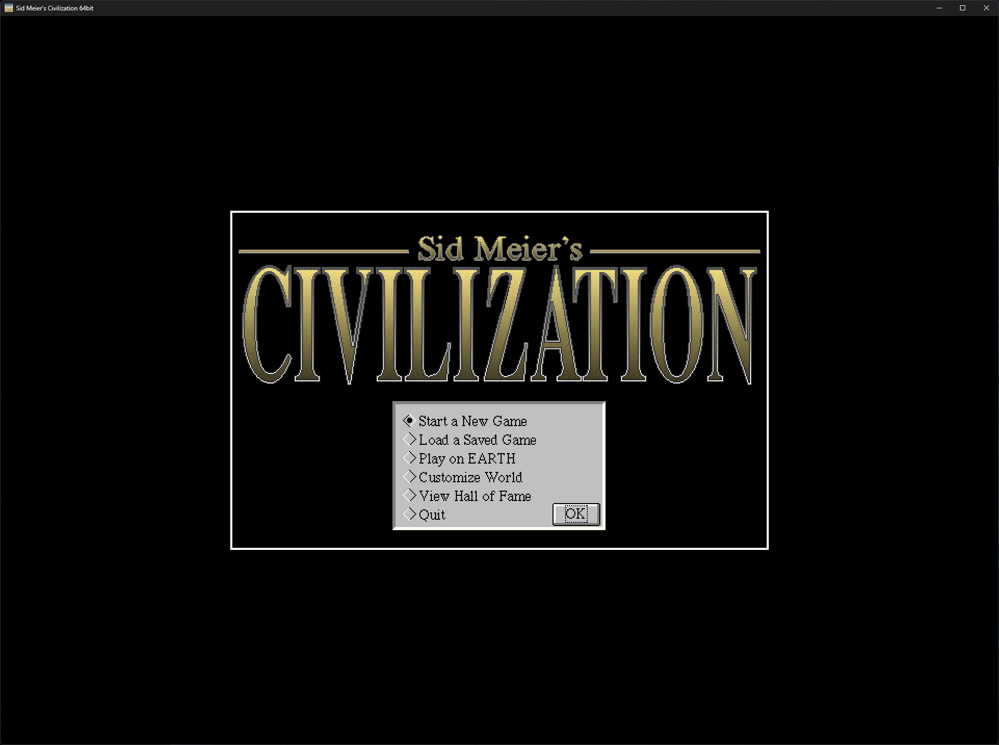
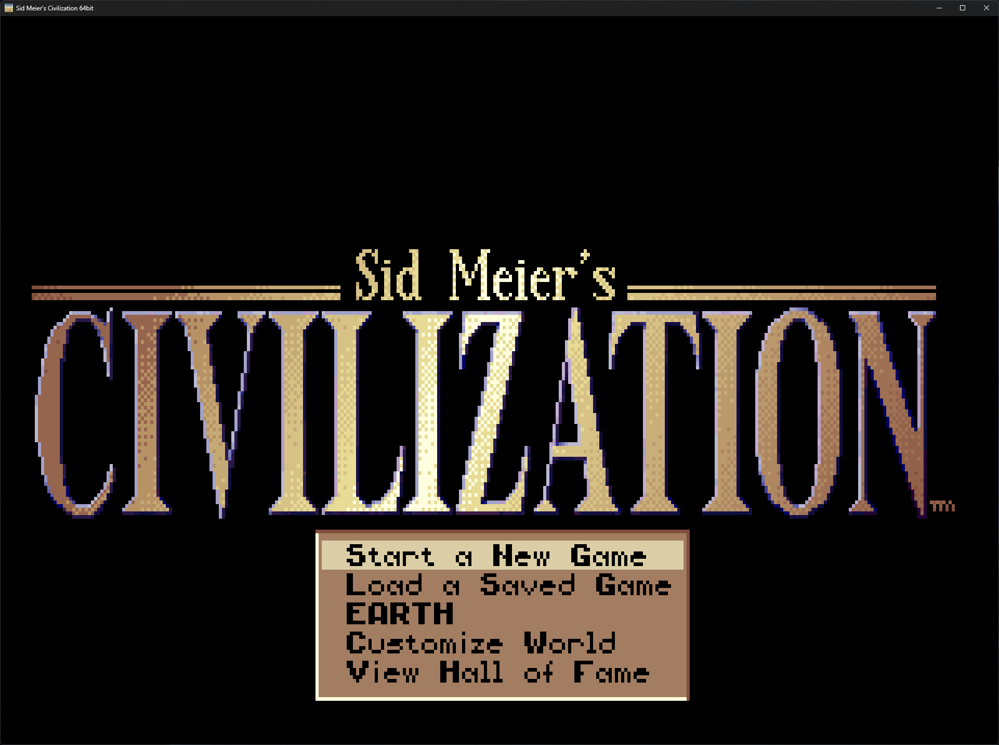
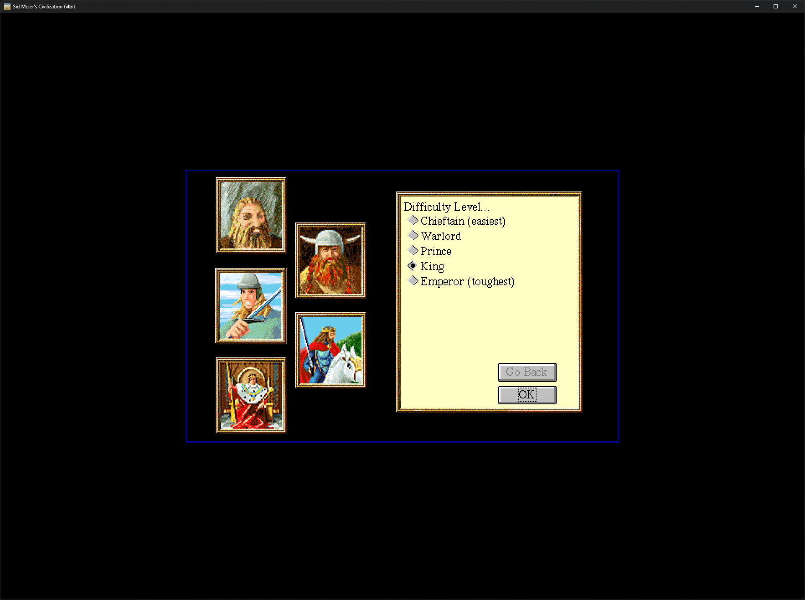
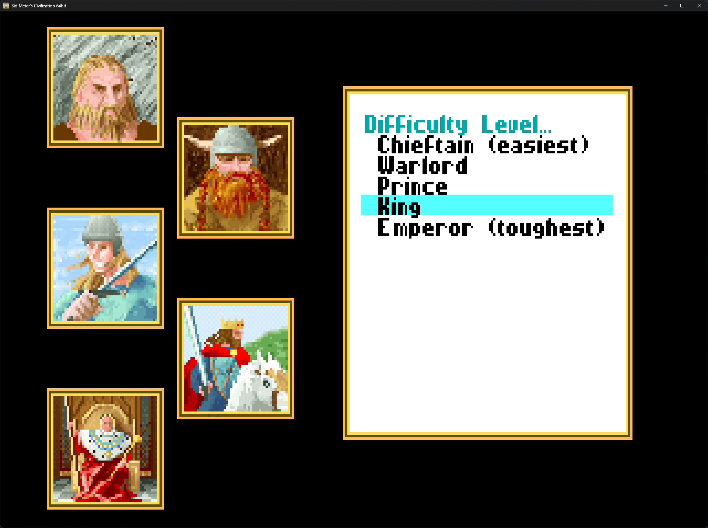
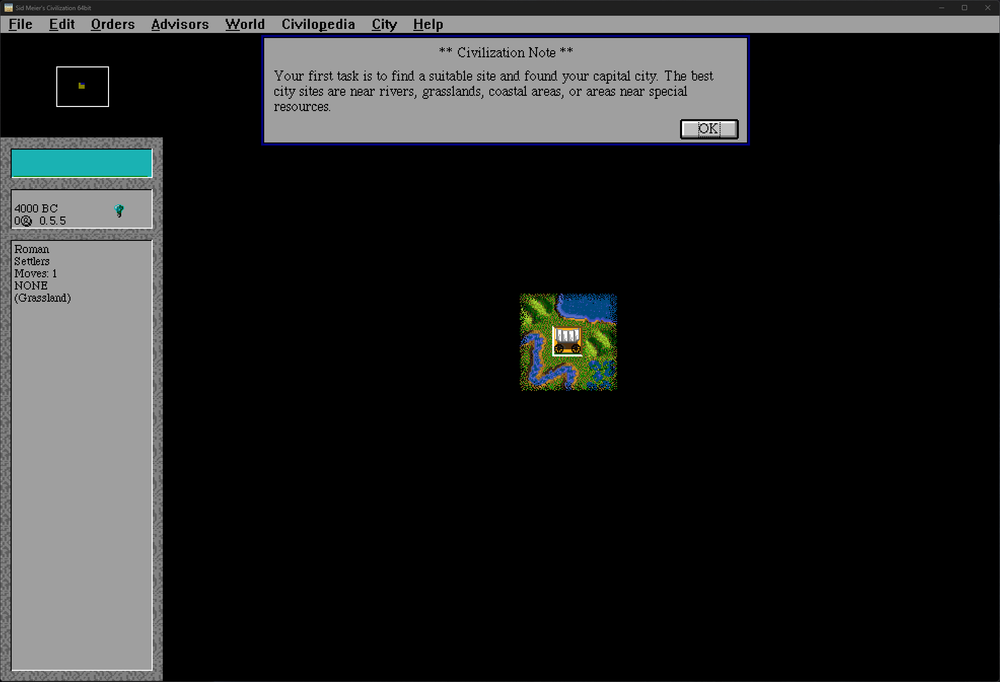
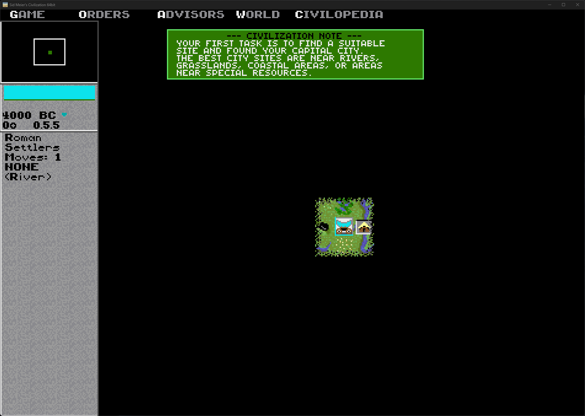
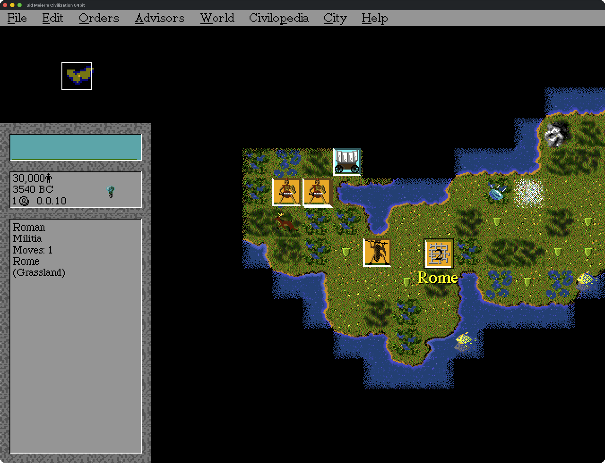
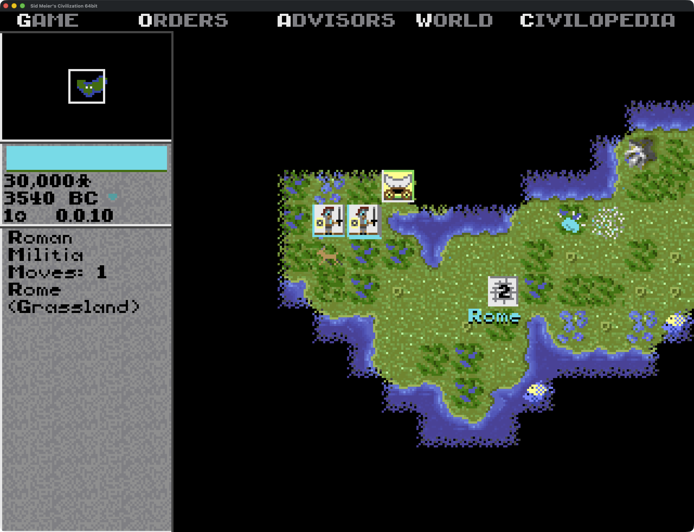
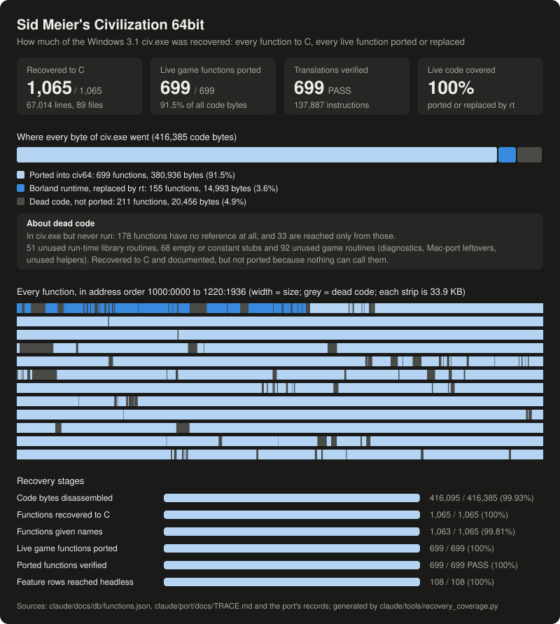

# Sid Meier's Civilization 64bit (civ64)

<table>
  <tr>
    <td width="50%"></td>
    <td width="50%"></td>
  </tr>
  <tr>
    <td align="center">Title menu, Windows graphics</td>
    <td align="center">Title menu, DOS graphics</td>
  </tr>
  <tr>
    <td width="50%"></td>
    <td width="50%"></td>
  </tr>
  <tr>
    <td align="center">Game setup, Windows graphics</td>
    <td align="center">Game setup, DOS graphics</td>
  </tr>
  <tr>
    <td width="50%"></td>
    <td width="50%"></td>
  </tr>
  <tr>
    <td align="center">Windowless play, Windows graphics</td>
    <td align="center">Windowless play, DOS graphics</td>
  </tr>
  <tr>
    <td width="50%"></td>
    <td width="50%"></td>
  </tr>
  <tr>
    <td align="center">On macOS, Windows graphics</td>
    <td align="center">On macOS, DOS graphics</td>
  </tr>
</table>

  
   
  <b>On-the-fly graphics switch:</b> press <b>Ctrl+Shift+Backspace</b> (on a Mac <b>Shift+Command+Delete</b>),
  or use the <b>Graphics</b> submenu, at any moment, and the same game continues with the other graphics.

> **AI assistance and disclaimer of liability.** This project was made with the assistance of
> Anthropic's Claude AI. The reverse engineering, the program, the tests and this documentation were
> produced with Claude under my direction, and I tested the results myself. Because the work was
> produced with AI assistance, it may contain errors that neither the AI nor I have found.
> **Therefore the software and the documentation are provided "as is", without warranty of any
> kind, express or implied. You use them entirely at your own risk, and I accept no liability for
> any damage, data loss or other harm arising from their use.** Back up your game files and saved
> games before you use civ64.
>
> **Trademarks and affiliation.** Sid Meier's Civilization, its program, art, sound and data belong
> to their owners. This is a fan project. It is not affiliated with or endorsed by Firaxis Games,
> 2K, Take-Two Interactive or MicroProse. None of the game's files are included here or in the
> release: you need your own copy of the game to play.

**Sid Meier's Civilization 64bit** (`civ64.exe`, "civ64") runs the original 1992 *Sid Meier's
Civilization for Windows*, the 16-bit Windows 3.1 release, as a native 64-bit Windows program and, since
1.2.2, as a native macOS application (`Civ64.app`, Apple silicon and Intel). It needs no DOSBox, no
winevdm/OTVDM, no Wine and no virtual machine. It plays the whole original game, from the
opening credits to the end games, on your own copy of the game's files, and it can switch to the
graphics of *Civilization for DOS* and back at any moment.

## Quick start

The Windows program is below; **on a Mac**, see [Quick start on macOS](#quick-start-on-macos).

**Requirements**

* Windows 10 (version 1607 or later) or Windows 11, 64-bit. No installer, no administrator rights,
  no extra run-time libraries.
* **On Windows 7** (SP1, 64-bit): use `Civ64-Win7.exe` instead, the same program and version built to
  run on Windows 7 as well (new in v1.2.4; not yet run on Windows 7 itself, see the
  [User Guide](docs/USER-GUIDE.md#1-requirements)). Everything below applies to it with
  `Civ64-Win7.exe` in place of `civ64.exe`.
* **Your own copy of Sid Meier's Civilization for Windows** (the Windows 3.1 release), with all of
  its files: `civ.exe`, the `.rsc` and `.wav` files, `civfonts.fon` and the others. civ64 accepts
  exactly one release: `civ.exe` of 832,512 bytes with SHA-256
  `a66ec64020f10adb81613964f3d08a11ea278b6a5a060c8e49d1ea1fd3ba1788`.
* **Optional, for the DOS graphics:** your own copy of *Civilization for DOS*, version 475.05
  (`CIV.EXE` of 305,030 bytes; the game's own `INTRO.TXT` may still say 475.01). civ64 checks every
  DOS file it uses: all must be the unchanged files of that version. Without it civ64 plays normally
  with the Windows graphics.

**First run**

1. Download `civ64.exe` (on Windows 7: `Civ64-Win7.exe`) from the
   [latest release](https://github.com/Buyukcaglar/Civ64/releases/latest) into a folder of its own.
2. Next to it, put a `CivWin` folder holding a copy of your Civilization for Windows files, or a ZIP
   of them named `CivWin.zip` (also `Civ-Win.zip` or `Civ_Win.zip`). For the DOS graphics, add a
   `CivDos` folder or `CivDos.zip` (also `Civ-Dos.zip` or `Civ_Dos.zip`).
3. Run `civ64.exe`. If it finds no game files, it asks you to locate the game's `civ.exe` or ZIP file
   and remembers your choice.

**Optional extras (new in 1.1)**

* **Windowless play:** window menu > **Display** > **Windowless play** shows the menu bar, the map,
  the World Map and the Status panel as one picture, like the DOS game's screen, without window
  frames. It works with both graphics and can be switched at any time; since 1.2 the picture fills the
  whole window, without a black border, and since 1.2.1 the Windows graphics' menus have a gray bar and a
  stone background (built into `civ64.exe`, no extra file).
* **4:3 DOS gameplay:** **Display** > **4:3 aspect ratio for 320 x 200 DOS gameplay** gives the whole
  game with the DOS graphics the 4:3 shape of a DOS monitor (the intro screens have their own item).
* **CRT scanlines:** **Display** > **CRT scanlines** adds the dark lines of a CRT monitor, with sharp
  pixels and no slowdown; since 1.2.1 double-scanned and the same on every screen, at every window size
  and in full screen.
* **Your own music and sound effects:** put a `MusicSfx` folder or a `MusicSfx.zip` next to
  `civ64.exe`, holding WAV files named like the game's own (`OPENING.WAV`, `CANNON.WAV`, ... any of
  its 24 sound files). Each file you supply is played instead of the game's file of that name; the
  others stay the game's own. **No music or sound files are included: you supply your own.** The
  window menu's **Alternative music/soundfx** turns them off and on.

All of these are remembered between runs; the [User Guide](docs/USER-GUIDE.md) has the details.

**Main keys**

| Key or action | What it does |
|---|---|
| Ctrl+Shift+Backspace | Switch between the Windows and the DOS graphics |
| Alt+Enter | Full screen on or off |
| Ctrl+Shift+Plus, Ctrl+Shift+Minus | Map zoom one step in or out (half, three quarters, normal, one and a half, double size) |
| Ctrl+Shift+0 or Ctrl+Shift+Home | Normal map zoom |
| Mouse wheel over the map | Map zoom around the pointer |
| Click the icon at the left of the title bar, or right-click the title bar | The window menu: Full screen, Display (windowless play, scaling, filter, CRT scanlines, 4:3), Map zoom, Graphics, Alternative music/soundfx, About; the game pauses while it is open |
| Any key during the opening credits | Skip to the title menu |
| Alt+F4 or the window's close button | Exit (during a game civ64 asks first; save through the game's File menu) |

The full **[User Guide](docs/USER-GUIDE.md)** covers installation, every menu and key, both
graphics, the map zoom, the window and full screen, saves, settings, the command line and
troubleshooting.

### Quick start on macOS

**Requirements:** macOS 13 Ventura or later, Apple silicon or Intel; your own copy of Civilization for
Windows (the same release as above) and, optionally, of Civilization for DOS 475.05.

1. Download `Civ64-1.2.4-macOS.dmg` from the
   [v1.2.4 release](https://github.com/Buyukcaglar/Civ64/releases/tag/v1.2.4) (the macOS application's latest version), open it and drag `Civ64.app`
   to Applications or to a folder of its own. civ64 is signed with the developer's Developer ID and
   notarized by Apple.
2. Put `CivWin.zip` (and optionally `CivDos.zip`, `MusicSfx.zip`) or the `CivWin` / `CivDos` folders next
   to `Civ64.app`, or let civ64 ask for them at the first start. Optionally add `vgasys.fon` from a
   Windows PC (`C:\Windows\Fonts`) for the exact Windows 3.1 font in the game's dialogs.
3. Start civ64 from where you put it.

On a Mac, Option is Alt. civ64's commands are in the **civ64** menu of the macOS menu bar, the game's
own menus are both in its window and in the macOS menu bar, and the keys have Mac shortcuts:
**Shift+Command+Delete** switches the graphics, **Command+=**, **Command+-** and **Command+0** zoom the
map, **Control+Command+F** is full screen and **Command+Q** quits. The Windows keys work too. Details:
[User Guide, section 15](docs/USER-GUIDE.md#15-civ64-for-macos).

## What this project is

civ64 is a faithful port, not a remake. The original `civ.exe`, a 16-bit Borland C++ program, was
reverse-engineered from its machine code: all 1,065 of its functions were recovered as readable C
(about 67,000 lines). The 699 functions that can actually run were translated into portable C
(about 124,000 lines), and every one of them was compared instruction by instruction with the
original machine code (137,887 instructions, 11 review rounds). The Borland run-time library was
replaced by an exact re-implementation, and the Windows 3.1 environment the game expects (windows,
dialogs, controls, 256-colour palettes, fonts, timers and 16-bit memory) is re-created inside civ64.
The rules, the computer players, the map generator, the random-number generator, the save files and
the screens are the original's, its bugs included.

Additions only change what you see, never what happens in the game: a resizable window and full
screen, scaling with sharp or smooth pixels, a game screen that grows with the window, 1:1 pixels in
gameplay, a five-level map zoom, light and dark title bars, and the DOS graphics profile, which shows the DOS version's
pictures, palettes, fonts, menus and screens for the same running game. Save files keep the original
format: civ64 loads saves of the original game, and the original game loads civ64's saves.

### New in version 1.2.5

* **1:1 pixels in gameplay:** a new item in the window menu's **Display** submenu, below **Fit to
  window**. Checked, every picture of a game is drawn at its original size, one screen pixel per pixel,
  in both graphics: the Windows 3.1 desktop with the game's windows, dialogs and menus, the windowless
  picture, the DOS play screen and the DOS 320 x 200 screens. The game screen takes the window's size,
  so a large window shows more of the desktop and the map.
* **Never more than the whole world:** the largest game screen, 2726 x 1600, is the whole world map
  beside the World Map and Status column. On a larger window (for example 4K full screen) 1:1 gives
  way to the smallest whole step, 2 x 2 or more, so the picture fills the screen and the map never
  covers more than the whole world.
* While it is checked the map zoom goes no further out than normal, and the 4:3 items do not apply;
  the intro, title, Birth and setup screens keep your Integer / Fit choice. Your choice is remembered.
* The program's version information and its About box say 1.2.5, in `civ64.exe` and
  `Civ64-Win7.exe`. This release is for Windows; the macOS application stays at 1.2.4 (in the
  [v1.2.4 release](https://github.com/Buyukcaglar/Civ64/releases/tag/v1.2.4)), without the 1:1 item.

### New in version 1.2.4

* **Two more map zoom steps:** the map zoom has five levels now, half, three quarters, normal, one and
  a half and double size (before: half, normal, double). Ctrl+Shift+Plus, Ctrl+Shift+Minus and the
  mouse wheel go one level at a time, in both graphics.
* **Zoom out and Zoom in in the window menu** (were "Zoom out (half)" and "Zoom in (double)") go one
  level each time you choose them, as the keys do, so choosing one again goes on in the same direction.
  **Normal zoom** is checked at normal size; Zoom out is gray at half size, Zoom in at double size.
* A zoom level remembered by an earlier version keeps its size. `--zoom` takes `-2` to `+2` (half is
  now `-2`, double `+2`).
* The program's version information and its About box say 1.2.4. The macOS application is 1.2.4 too,
  with the five levels and the one-step **Zoom Out** / **Zoom In** of its Map Zoom menu; on a Mac the
  DOS "not found" message now names `Civ64.app`.

### New in version 1.2.3

* **Fix, DOS files:** a copy of the DOS game whose `CIV.EXE` was right but another file was not (changed
  by a mod, or left from another release next to a patched `CIV.EXE`) was accepted; the switch to the
  DOS graphics was then refused, and **Locate DOS files…** accepted the same copy again at every start.
  civ64 now checks every DOS file it uses wherever it finds or is given the DOS copy, and names the
  first wrong file and its folder or ZIP; Locate refuses such a copy and asks again.
* A `CIV.EXE` that is not the supported one now says "Version 475.05 is required."
* The program's version information and its About box say 1.2.3. The macOS application is 1.2.3 too, with
  the same check of the DOS files.

### New in version 1.2.2

* **civ64 for macOS:** `Civ64.app`, one universal application for Apple silicon and Intel Macs (macOS 13
  or later), signed with a Developer ID and notarized by Apple, in a disk image. It runs the same game and
  both graphics; the game's menus also appear in the macOS menu bar, and civ64's commands are in the
  application menu with Mac shortcuts. The two fixes below were found while making it.
* **Fix, DOS graphics, windowless play:** with a narrow map window (for example a 4:3 window), the DOS
  menu bar's CIVILOPEDIA title was cut and a stripe of its letters repeated after it; the bar now shows
  all five DOS titles whole at their DOS places.
* **Fix, DOS graphics, after Load a Saved Game:** the first advisor report showed the advisor's portrait
  in wrong colours (later views were right); the game's colours are now set as the DOS game sets them
  right after a load.
* The program's version information and its About box say 1.2.2 (on a Mac, the application's version and
  its About box).

### New in version 1.2.1

* **CRT scanlines, reworked:** double-scanned in both graphics (two scanlines per picture row, like
  DOSBox Pure's double-scan), visible at every window size and full-screen scale (the Windows graphics
  showed none at some common sizes), spaced in a window exactly as in full screen on its monitor, and
  the same during play as on the intro, title, Birth and setup screens.
* **Windowless play, Windows graphics menus:** the menu bar takes the Status window's gray, the menus
  that drop from it a seamless stone background (built into `civ64.exe`), and their unavailable items
  stay readable on the stones.
* **Torch cursor over the menus:** in the Windows graphics the menu bar and an open menu always show
  the game's torch cursor, also when the pointer comes from the World Map.
* **The game pauses while the window menu is open** (and while the window is moved or resized, and
  while civ64's own boxes are open): the game, its animations, music and sounds stand still and go on
  where they stopped, without a fast catch-up afterwards.
* **Fix:** started in full screen, the title bar had no icon after Alt+Enter; it now shows civ64's
  icon in every start mode and after every switch.
* The program's version information and its About box say 1.2.1; the About box links to this
  repository.

### New in version 1.2

* **Windowless play fills the whole window** (Windows and DOS graphics): no black border around the
  picture any more; the game's map window grows by the removed frames and scroll bars, so the map
  shows a little more land.
* The program's version information and its About box say 1.2.

### New in version 1.1

* **Windowless play** (Windows and DOS graphics): the game's menu bar, map, World Map and Status
  panel form one frameless picture, laid out like the DOS game's screen; dialogs and menus float
  over it.
* **4:3 for the DOS gameplay**: the whole DOS-graphics game, not only the intro screens, can take the
  4:3 shape of a DOS monitor.
* **CRT scanlines**: an optional CRT scanline effect modelled on DOSBox Pure Unleashed's CRT filter,
  as sharp as the picture without it.
* **Alternative music and sound effects**: your own WAV files from a `MusicSfx` folder or
  `MusicSfx.zip` replace the game's sounds of the same names (none are included).
* **Fix:** with the DOS graphics, the science advisor's recommendation now stands on the Status
  window, as in the DOS game, instead of in a second box.

### Recovery coverage

Every function of `civ.exe` has been recovered to C, and all 699 live game functions are ported into
civ64: **91.5% of the executable's code bytes**. The other 8.5% is the Borland C run-time library
(3.6%, replaced by civ64's own run-time layer) and dead code that nothing can call (4.9%). Details,
evidence and caveats: [docs/recovery-coverage.md](docs/recovery-coverage.md).

## What this repository holds, and why

| | |
|---|---|
| **Here now** | This README, the [User Guide](docs/USER-GUIDE.md) and the complete project documentation in [docs/](docs/README.md): the design, the fidelity register, the feature list, the DOS-profile tables, the phase and unit records, the reviews, the audits, the measured test results and the screenshots. The program itself is attached to each release as `civ64.exe` (since v1.2.4 also `Civ64-Win7.exe`, the build for Windows 7), and since v1.2.2 also the macOS application (`Civ64-1.2.4-macOS.dmg` in v1.2.4, `Civ64-1.2.3-macOS.dmg` in v1.2.3, `Civ64-1.2.2-macOS.dmg` in v1.2.2): the [latest release](https://github.com/Buyukcaglar/Civ64/releases/latest) is [v1.2.5](https://github.com/Buyukcaglar/Civ64/releases/tag/v1.2.5); the earlier ones are [v1.2.4](https://github.com/Buyukcaglar/Civ64/releases/tag/v1.2.4) (with the macOS application 1.2.4), [v1.2.3](https://github.com/Buyukcaglar/Civ64/releases/tag/v1.2.3) (with the macOS application 1.2.3), [v1.2.2](https://github.com/Buyukcaglar/Civ64/releases/tag/v1.2.2) (with the macOS application), [v1.2.1](https://github.com/Buyukcaglar/Civ64/releases/tag/v1.2.1), [v1.2](https://github.com/Buyukcaglar/Civ64/releases/tag/v1.2), [v1.1](https://github.com/Buyukcaglar/Civ64/releases/tag/v1.1) and [v1.0](https://github.com/Buyukcaglar/Civ64/releases/tag/v1.0). |
| **Later** | The independently written code of civ64: the Windows 3.1 emulation layer and the Windows host, the run-time library replacement, the presentation (scaling, map zoom, the DOS graphics profile), the tests and the build scripts. It will be published here as the last task of the project. On its own it does not build a playable game. |
| **Not published** | The recovered C of `civ.exe` and the game core translated from it, the disassembly listings, the original game's string inventory, and every file of the original games. |

The recovered C and the core translated from it are readings of the copyrighted original program,
so they are not published. The released `civ64.exe` contains none of the original game's files or
bytes, and neither does `Civ64.app`: they read your own copy at run time and check that it is the exact
supported release. The
documentation describes the work in full; where a record quoted program code, the public copy
condenses that passage into a description ([audit summary in docs/README.md](docs/README.md#9-how-the-public-copy-was-prepared)).

## Documentation

* [docs/USER-GUIDE.md](docs/USER-GUIDE.md): how to install, run and play civ64.
* [docs/README.md](docs/README.md): the whole work from start to finish (phases, methodology,
  tests, findings and measured data) with an index of every document.

## Licence

civ64's About box carries its licence: the MIT licence, Copyright (c) 2026 Onur BUYUKCAGLAR, for
the port's own code. It does not cover Sid Meier's Civilization, its program or its data, which
belong to their owners.
