# Sid Meier's Civilization 64bit (civ64)

<table>
  <tr>
    <td width="50%">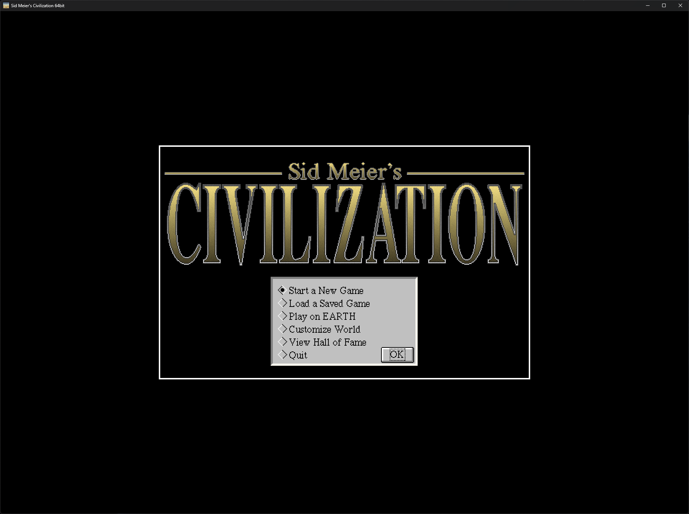</td>
    <td width="50%">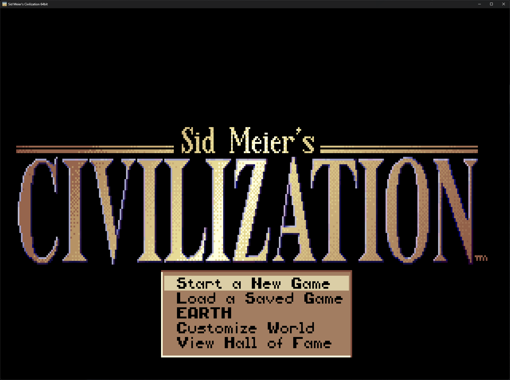</td>
  </tr>
  <tr>
    <td align="center">Title menu, Windows graphics</td>
    <td align="center">Title menu, DOS graphics</td>
  </tr>
  <tr>
    <td width="50%">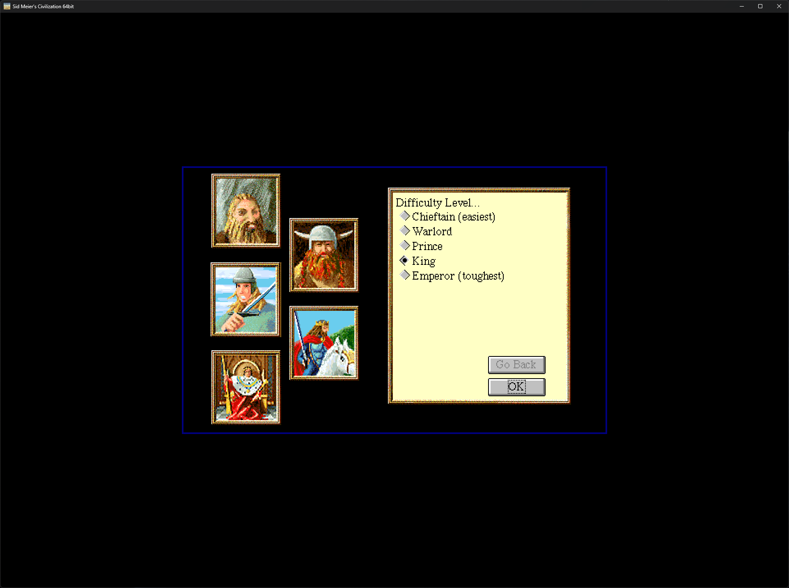</td>
    <td width="50%">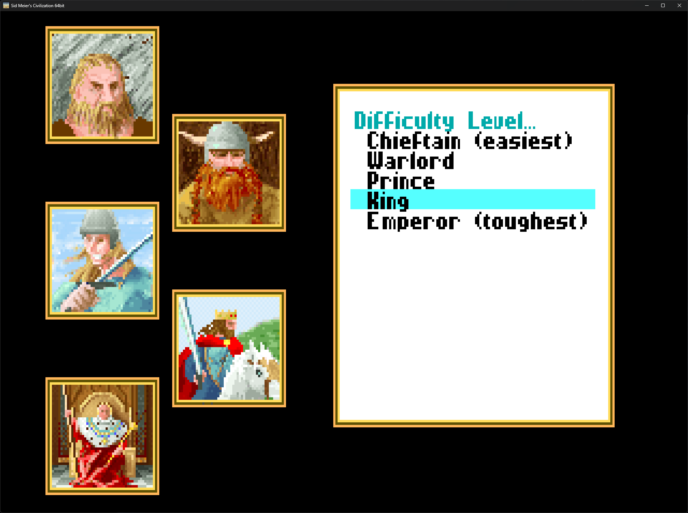</td>
  </tr>
  <tr>
    <td align="center">Game setup, Windows graphics</td>
    <td align="center">Game setup, DOS graphics</td>
  </tr>
  <tr>
    <td width="50%">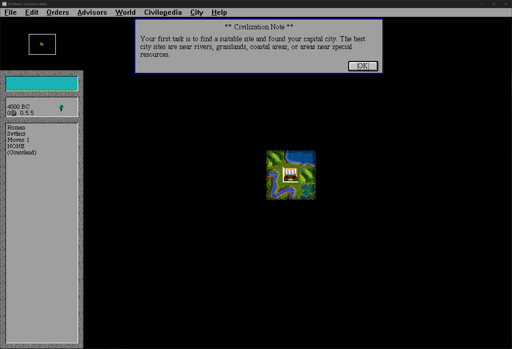</td>
    <td width="50%">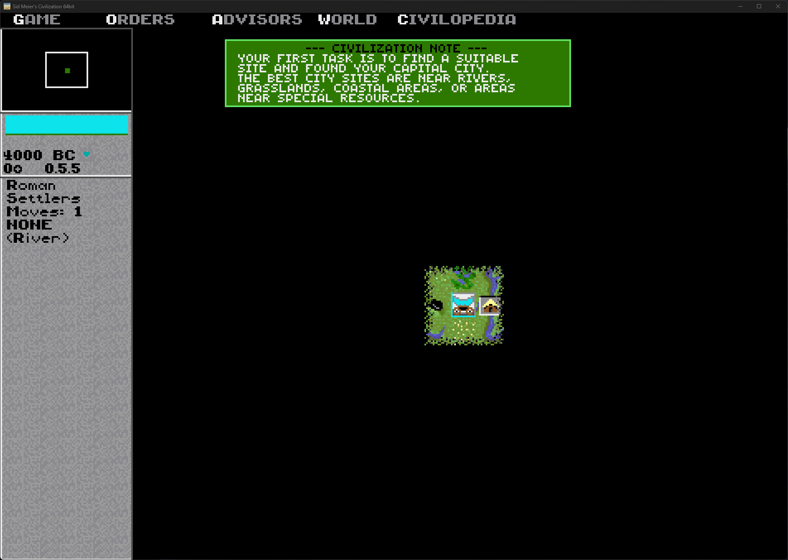</td>
  </tr>
  <tr>
    <td align="center">Windowless play, Windows graphics</td>
    <td align="center">Windowless play, DOS graphics</td>
  </tr>
  <tr>
    <td width="50%">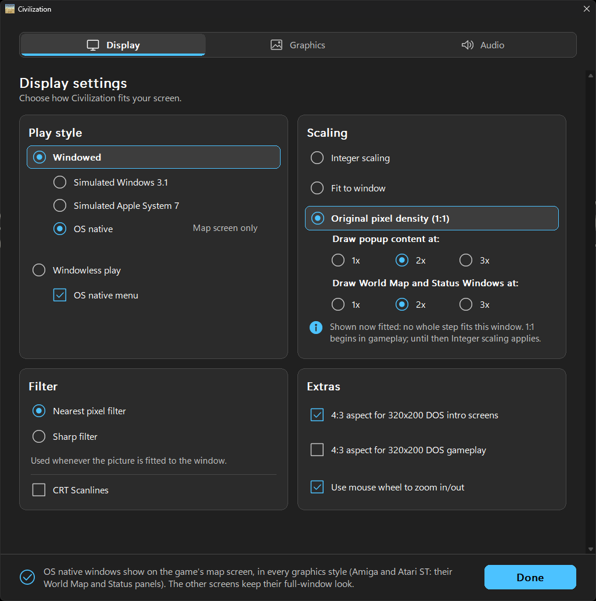</td>
    <td width="50%">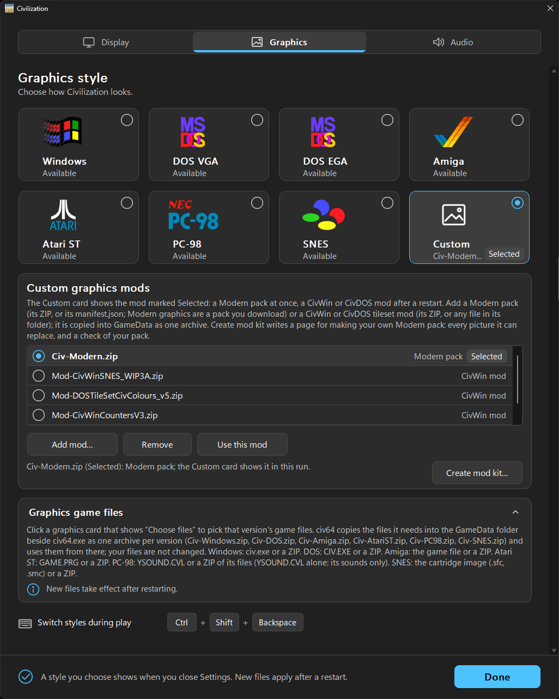</td>
  </tr>
  <tr>
    <td align="center">Options, Display (new in 1.3)</td>
    <td align="center">Options, Graphics (new in 1.3)</td>
  </tr>
  <tr>
    <td width="50%">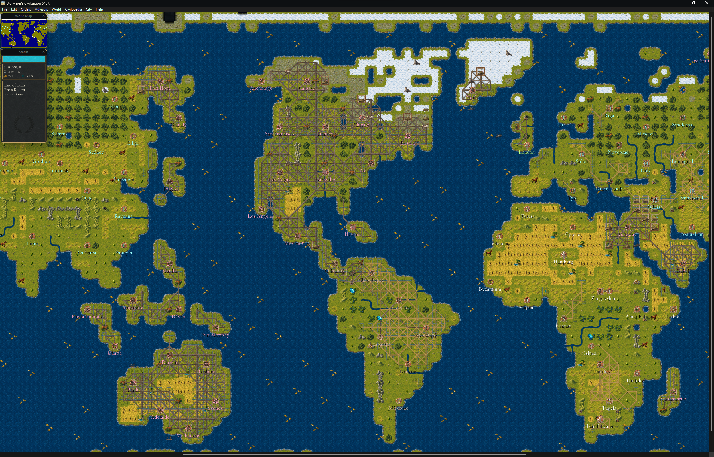</td>
    <td width="50%">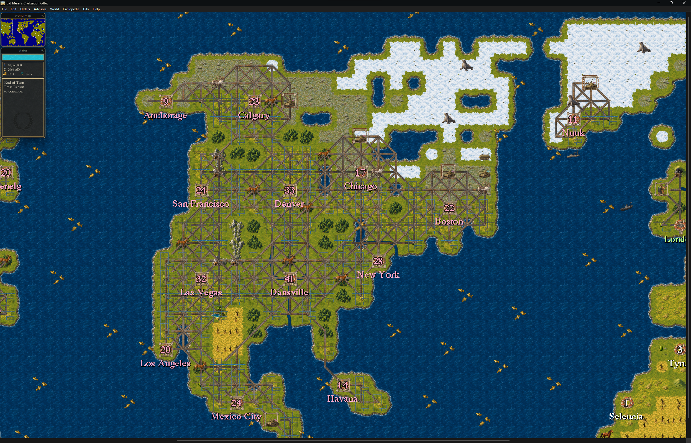</td>
  </tr>
  <tr>
    <td align="center">A Modern-style graphics pack (obtained separately, not included), 1:1</td>
    <td align="center">The same, map zoomed in</td>
  </tr>
  <tr>
    <td width="50%">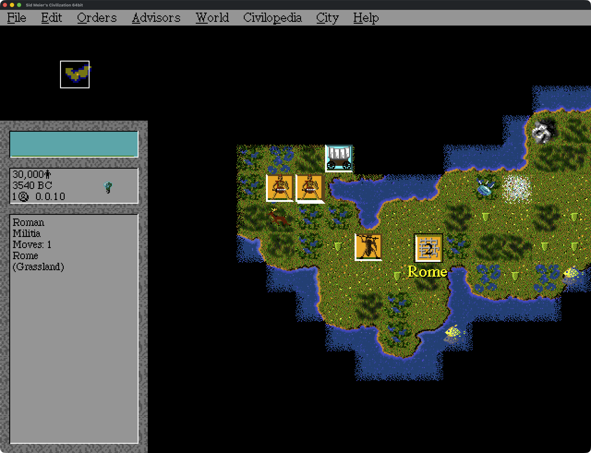</td>
    <td width="50%">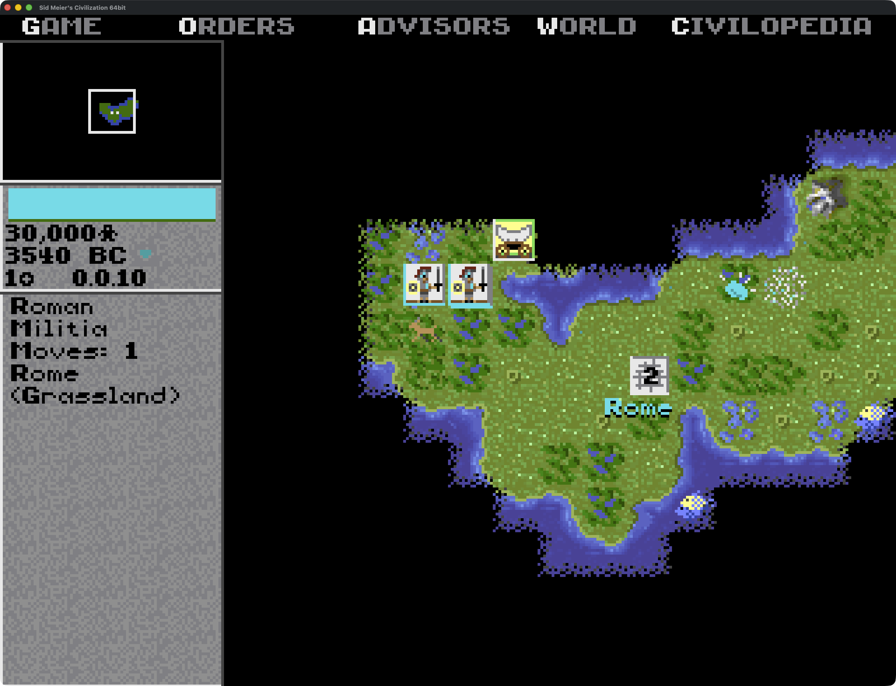</td>
  </tr>
  <tr>
    <td align="center">On macOS, Windows graphics</td>
    <td align="center">On macOS, DOS graphics</td>
  </tr>
</table>

  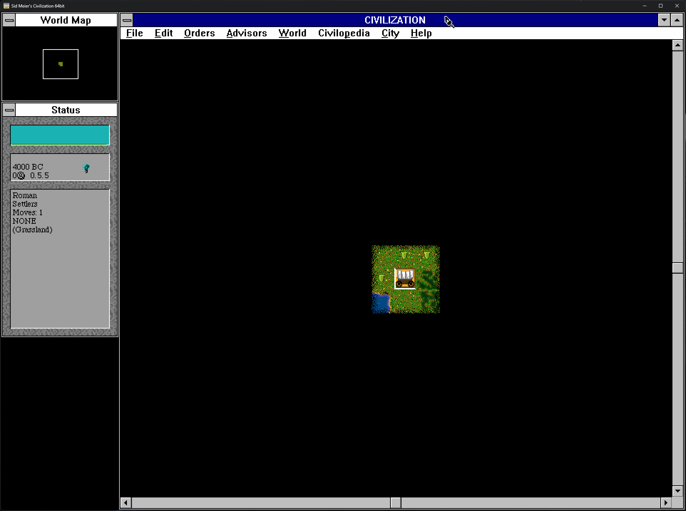
   
  <b>On-the-fly graphics switch:</b> press <b>Ctrl+Shift+Backspace</b> (on a Mac <b>Shift+Command+Delete</b>),
  or choose a style on the <b>Options</b> dialog's <b>Graphics</b> page, at any moment, and the same game continues
  with the other graphics.

> **AI assistance and disclaimer of liability.** This project was made with the assistance of
> Anthropic's Claude AI. The reverse engineering, the program, the tests and this documentation were
> produced with Claude under my direction, and I tested the results myself. Because the work was
> produced with AI assistance, it may contain errors that neither the AI nor I have found.
> **Therefore the software and the documentation are provided "as is", without warranty of any
> kind, express or implied. You use them entirely at your own risk, and I accept no liability for
> any damage, data loss or other harm arising from their use.** Back up your game files and saved
> games before you use civ64.
>
> **Trademarks and affiliation.** Sid Meier's Civilization, its program, art, sound and data belong
> to their owners. This is a fan project. It is not affiliated with or endorsed by Firaxis Games,
> 2K, Take-Two Interactive or MicroProse. The names of the computers and consoles civ64 can imitate
> (Windows, MS-DOS, Amiga, Atari ST, PC-98, SNES, Roland MT-32) belong to their owners. None of the
> games' files are included here or in the release: you need your own copy of the game to play.

**Sid Meier's Civilization 64bit** (`civ64.exe`, "civ64") runs the original 1992 *Sid Meier's
Civilization for Windows*, the 16-bit Windows 3.1 release, as a native 64-bit Windows program and, since
1.2.2, as a native macOS application (`Civ64.app`, Apple silicon and Intel). It needs no DOSBox, no
winevdm/OTVDM, no Wine and no virtual machine. It plays the whole original game, from the
opening credits to the end games, on your own copy of the game's files. At any moment it can switch the
same running game to the graphics of *Civilization for DOS* and, since 1.3, of the Amiga, Atari ST,
PC-98 and SNES editions, and play the music and sound effects of those editions, each from your own copy
of that edition's files.

## Quick start

The Windows program is below; **on a Mac**, see [Quick start on macOS](#quick-start-on-macos).

**Requirements**

* Windows 10 (version 1607 or later) or Windows 11, 64-bit. No installer, no administrator rights,
  no extra run-time libraries.
* **On Windows 7** (SP1, 64-bit): use `Civ64-Win7.exe` instead, the same program and version built to
  run on Windows 7 as well (not yet run on Windows 7 itself, see the
  [User Guide](docs/USER-GUIDE.md#1-requirements)). Everything below applies to it with
  `Civ64-Win7.exe` in place of `civ64.exe`.
* **Your own copy of Sid Meier's Civilization for Windows** (the Windows 3.1 release), with all of
  its files: `civ.exe`, the `.rsc` and `.wav` files, `civfonts.fon` and the others. civ64 accepts
  exactly one release: `civ.exe` of 832,512 bytes with SHA-256
  `a66ec64020f10adb81613964f3d08a11ea278b6a5a060c8e49d1ea1fd3ba1788`.
* **Optional, for the DOS graphics and sounds:** your own copy of *Civilization for DOS*, version 475.05
  (`CIV.EXE` of 305,030 bytes; the game's own `INTRO.TXT` may still say 475.01). civ64 checks every
  DOS file it uses: all must be the unchanged files of that version. Without it civ64 plays normally
  with the Windows graphics.
* **Optional, for the other editions' graphics and sounds:** your own copies of their files (the Amiga,
  Atari ST, PC-98 and SNES editions; for the DOS game's Roland MT-32 music, the MT-32's ROMs). The
  [User Guide](docs/USER-GUIDE.md#3-where-civ64-finds-the-game) says which files each one needs.

**First run**

1. Download `Civ64-1.3.2-Windows.zip` (on Windows 7: `Civ64-1.3.2-Win7.zip`) from the
   [v1.3.2 release](https://github.com/Buyukcaglar/Civ64/releases/tag/v1.3.2) (the Windows ZIP files of 1.3.3
   follow; v1.3.3 holds the macOS application for now) and unpack it into a folder of its
   own. It holds `civ64.exe` (`Civ64-Win7.exe`), `units.ini` and `README-units.txt`; the last two are the
   optional unit rules (below), and `units.ini` as shipped holds the original values.
2. Run `civ64.exe`. At the first start it asks for one thing only: the game's `civ.exe` (in your
   Civilization for Windows folder) or a ZIP file of the game.
3. civ64 checks what you chose and **copies the files it needs into a `GameData` folder next to
   `civ64.exe`** as `Civ-Windows.zip`, and from then on uses them from there. Your own files are never
   changed, and you are not asked again. Your saved games go to a `Save` folder next to `civ64.exe`.
4. Everything else is up to you, on the window menu's **Options…**: the DOS and other editions' files (a
   card's **Choose files**), your own sounds and graphics mods. civ64 copies each into `GameData` in the
   same way and uses it from the next start.

So the folder of `civ64.exe` must be one you can write to (not `C:\Program Files`), with room for the
copies (a few MB per edition). You can also put the archives into `GameData` yourself
([the file table](docs/USER-GUIDE.md#3-where-civ64-finds-the-game)). Cancel in a file dialog ends the
choice with nothing changed.

**Upgrading from 1.3 or 1.3.1.** Replace `civ64.exe` with the one in the ZIP file; your settings, `GameData` and
`Save` folders stay. Copy `units.ini` beside it only if you want to change unit stats.

**Upgrading from 1.2.5 or earlier.** Replace `civ64.exe`; your settings stay. A game or DOS location you
chose in an earlier version that still exists is copied into `GameData` at the first start of 1.3, without
a question. Version 1.3 no longer looks for `CivWin.zip`, `CivDos.zip` or `MusicSfx.zip` (or the `CivWin`,
`CivDos` and `MusicSfx` folders) next to `civ64.exe`: when civ64 asks for the Windows game, choose your old
`CivWin.zip` (or `civ.exe`), and choose the DOS files and your sounds on the Options dialog; civ64 copies
them into `GameData`. If you played from a `CivWin.zip`, your saves are in `%LOCALAPPDATA%\civ64\CivWin`: copy
the `.SAV` files into the new `Save` folder
([details](docs/USER-GUIDE.md#11-saves-settings-and-the-files-civ64-writes)).

**Options** (new in 1.3). The window menu's **Options…** opens one dialog with three pages:

* **Display:** windowed play with the game's windows drawn as **Simulated Windows 3.1**, **Simulated
  Apple System 7** or as **OS native** windows; **Windowless play**, which shows the menu bar, the map,
  the World Map and the Status panel as one picture like the DOS game's screen; the **OS native menu**;
  **Integer scaling**, **Fit to window** or **Original pixel density (1:1)**, with, at 1:1, the popups and
  the World Map and Status windows drawn 1x, 2x or 3x; the nearest-pixel or sharp filter; **CRT
  scanlines**; 4:3 for the DOS screens; the mouse wheel zoom.
* **Graphics:** the graphics style: **Windows**, **DOS VGA**, **DOS EGA**, **Amiga**, **Atari ST**,
  **PC-98**, **SNES** or **Custom**; the **Custom graphics mods** (community tileset mods for the Windows
  or DOS graphics, and Modern-style graphics packs that you obtain separately) with **Add mod…** and
  **Create mod kit…**; and, on a card that shows **Choose files**, the choice of that edition's files,
  which civ64 copies into `GameData`.
* **Audio:** the music and sound effects of **Windows**, the DOS game's **IBM**, **Tandy**,
  **AdLib/Sound Blaster** or **Roland MT-32** sound, **Amiga**, **Atari ST**, **SNES**, **NEC PC-98**, or
  **Custom** (your own WAV files, none included).

All of these are remembered between runs; the [User Guide](docs/USER-GUIDE.md) has the details.

**Main keys**

| Key or action | What it does |
|---|---|
| Ctrl+Shift+Backspace | Switch to the next graphics style whose files are loaded |
| Alt+Enter | Full screen on or off |
| Ctrl+Shift+Plus, Ctrl+Shift+Minus | Map zoom one step in or out (half, three quarters, normal, one and a half, double size) |
| Ctrl+Shift+0 or Ctrl+Shift+Home | Normal map zoom |
| Mouse wheel over the map | Map zoom around the pointer |
| Click the icon at the left of the title bar, or right-click the title bar | The window menu: Full screen, Options…, Add screen to mod kit, Zoom out, Normal zoom, Zoom in, About, Close; the game pauses while it is open |
| Any key during the opening credits | Skip to the title menu |
| Alt+F4 or the window's close button | Exit (during a game civ64 asks first; save through the game's File menu) |

The full **[User Guide](docs/USER-GUIDE.md)** covers installation, every menu, option and key, the
graphics styles, the map zoom, the window and full screen, saves, settings, the command line and
troubleshooting.

### Quick start on macOS

The macOS application `Civ64.app` is at version **1.3.3** (the Windows program at 1.3.2 until its 1.3.3 follows):
the Options dialog, every graphics style, the editions' sounds, the window styles, the 1:1 popup sizes, the filters, Save States,
`units.ini`, graphics mods and the mod kit, as on Windows. Only the **OS native** window style is not in it.

**Requirements:** macOS 13 Ventura or later, Apple silicon or Intel; your own copy of Civilization for
Windows (the same release as above) and, optionally, of the other editions.

1. Download `Civ64-1.3.3-macOS.dmg` from the
   [latest release](https://github.com/Buyukcaglar/Civ64/releases/latest), open it and drag `Civ64.app`
   to Applications. civ64 is signed with the developer's Developer ID and notarized by Apple.
2. Start it. At the first start it asks only for the Windows game (its folder, `civ.exe` or a ZIP) and copies
   the files it needs into `~/Library/Application Support/civ64/GameData`. Optionally add `vgasys.fon` from a
   Windows PC (`C:\Windows\Fonts`) to the game's folder for the exact Windows 3.1 font in the game's dialogs.
3. Everything else is on **civ64 > Options…** (Command+,), copied into the same `GameData` folder.
   Upgrading from 1.3, 1.3.1 or 1.3.2: drag the new `Civ64.app` over the old one; your settings, `GameData` and saves
   stay. Upgrading from 1.2.5: your settings stay, and the files 1.2.5 used are copied in at the first start.

On a Mac, Option is Alt. civ64's commands are in the **civ64** menu of the macOS menu bar, the game's
own menus are both in its window and in the macOS menu bar, and the keys have Mac shortcuts:
**Command+,** opens Options, **Shift+Command+Delete** switches the graphics, **Command+=**, **Command+-** and **Command+0** zoom the
map, **Control+Command+F** is full screen and **Command+Q** quits. The Windows keys work too. Details:
[User Guide, section 15](docs/USER-GUIDE.md#15-civ64-for-macos).

## What this project is

civ64 is a faithful port, not a remake. The original `civ.exe`, a 16-bit Borland C++ program, was
reverse-engineered from its machine code: all 1,065 of its functions were recovered as readable C
(about 67,000 lines). The 699 functions that can actually run were translated into portable C
(about 124,000 lines), and every one of them was compared instruction by instruction with the
original machine code (137,887 instructions, 11 review rounds). The Borland run-time library was
replaced by an exact re-implementation, and the Windows 3.1 environment the game expects (windows,
dialogs, controls, 256-colour palettes, fonts, timers and 16-bit memory) is re-created inside civ64.
The rules, the computer players, the map generator, the random-number generator, the save files and
the screens are the original's, its bugs included.

Additions only change what you see and hear, never what happens in the game: a resizable window and full
screen, scaling with sharp or smooth pixels, a game screen that grows with the window, 1:1 pixels in
gameplay, a five-level map zoom, light and dark title bars, windowless play, and the graphics and sounds of
the other editions of the game for the same running game: the DOS version's pictures, palettes, fonts,
menus and screens (with its VGA, EGA or PC-98 driver), the Amiga, Atari ST and SNES editions' own screens,
and graphics mods. Save files keep the original format: civ64 loads saves of the original game, and the
original game loads civ64's saves.

### New in version 1.3.3

On macOS first; the Windows ZIP files of 1.3.3 follow.

* **The numeric keypad moves like the arrow keys in menus and dialogs**, as in the DOS game: the game setup
  pages, Diplomacy, the lists, message boxes, the menu bar and the Save/Load slot screens. On the map the keypad
  still moves units, and in text fields it still types digits.
* **macOS: less CPU again.** Only the parts of the picture that change are composed, scaled and filtered, and the
  game checks its screen less often while it waits. Full screen on a 2560x1600 display, DOS graphics without
  windows at 1:1, idle: about 11% of a processor core (1.3.2: about 21%). The Smooth and Scale2x filters at
  integer scale now take about 10% (33 to 39% before their part of this work).
* **Unit animations keep their pace on slower Macs:** the picture's work during the game's timing waits is
  about a quarter of what it was, so a slow Mac is much less likely to stretch an attack or a move.
* **macOS: a minimised window draws nothing** until it is shown again; the game itself keeps running.

### New in version 1.3.2

* **City names under their cities:** on a large window the map can start above the world's top edge (black
  above the map); the original game then drew every city name as many squares too high as there were rows of
  black. This bug of the original game is fixed in the game's code itself, so the names are right with the
  Windows, DOS and PC-98 graphics alike. Game rules, the random numbers and saved games are not affected.
* **macOS: much less CPU on large displays:** the picture reaches the screen through the graphics processor,
  and only the changed part of it is copied each time.

### New in version 1.3.1

On Windows first; the macOS application has them since its own 1.3.1.

* **Smoothing filters:** the Options dialog's Display page has one **Filter** list: **Sharp pixels** (the
  default), **Smooth** (bilinear), **Smooth, crisp edges** (the earlier Sharp filter) and **Scale2x / Scale3x**
  (stair-steps rounded without new colours). They work on the zoomed map too and together with CRT Scanlines;
  an entry that cannot change the current picture is gray.
* **Save States:** five quick-save slots on the window menu (**Save State**, **Load State**), **Ctrl+F1** to
  **Ctrl+F5** to save and **Ctrl+Shift+F1** to **Ctrl+Shift+F5** to load, through the game's own save and
  load; the files are ordinary saved games in `Save\States`.
* **Unit stats from `units.ini`:** an optional text file beside `civ64.exe` sets the attack, defense, moves
  and cost of any unit for new games, with no hex editing; `README-units.txt` explains it. Both files come
  with the program, so **the downloads are ZIP files from now on**.
* **City names:** every visible city is named in the Windows and DOS graphics (the original names at most 32
  at a time, which left cities without a name on large 1:1 screens); with Modern-style packs names no longer
  flicker over animated water.
* **Graphics mods list themselves:** a tileset mod's archive placed in `GameData` (`Mod-<name>.zip`) appears
  in the Custom graphics mods list without **Add mod…**.
* **Fixes:** DOS EGA draws railroads, city walls and the terrain's shadows black, not magenta; with OS
  native windows the World Map's and Status window's title strips are no longer cut off on Windows 7, and
  leaving a DOS or SNES full screen (the city screen, a report) no longer makes the windows jump and flash;
  the refusal of a SNES cartridge image that is not the USA edition names the edition found.

### New in version 1.3

* **The Options dialog:** the window menu's **Options…** replaces its Display, Map zoom and Graphics
  submenus with one dialog of three pages, **Display**, **Graphics** and **Audio**. It opens on Display,
  and the game pauses while it is open.
* **Five more graphics styles:** **DOS EGA** (the DOS game drawn by its own EGA driver, 16 colours), **PC-98**
  (the DOS game with the pictures, sprites and palettes of the NEC PC-98 edition, in English, with the DOS
  game's Latin font at twice the size), **Amiga** and **Atari ST** (the layouts, art and fonts of those
  editions) and **SNES** (the SNES edition's screens, art, font and windows, with a menu bar at the top
  like the other styles; its intro and Birth run at their own pace, and the Birth follows the setup, as on
  the SNES). Each one is available when its edition's files are loaded, and Ctrl+Shift+Backspace steps
  through them. The DOS VGA, DOS EGA and PC-98 drivers switch live, like the other styles. Every style's
  play fills the window.
* **The editions' music and sound effects:** the Audio page plays the sounds of the Windows game, of the
  DOS game's IBM, Tandy, AdLib/Sound Blaster or Roland MT-32 sound (the MT-32 through a built-in MT-32
  emulation, from your own copy of the MT-32's ROMs), of the Amiga, Atari ST, SNES and PC-98 editions, or
  your own WAV files (**Custom**). The sound source is independent of the graphics style.
* **Window styles:** windowed play can draw the game's windows as **Simulated Windows 3.1**, as
  **Simulated Apple System 7** (System 7 frames, title bars, menus and buttons with a Chicago font), or as
  **OS native** windows: the map, World Map, Status and the game's dialogs become windows of their own with
  Windows' frames. The **OS native menu** shows the game's menus in the window's own Windows menu bar
  (with the Windows graphics).
* **1:1 popups and tool windows:** with **Original pixel density (1:1)**, the game's popups (from the
  Civilopedia to the city view) and the World Map and Status windows can be drawn 1x, 2x or 3x, sharp,
  so that they stay readable on large screens while the map stays at 1:1.
* **Custom graphics mods:** the **Custom** style shows one mod from your list: a community tileset mod for
  the Windows graphics (its `civdata0.rsc` to `civdata4.rsc`) or for the DOS graphics (its pictures and
  palettes), or a **Modern-style graphics pack**. **Add mod…** takes a mod's ZIP or folder and copies it
  into `GameData` as one archive; a mod added twice is recognised by its content. Whatever a mod lacks or
  that civ64 cannot use is drawn from the original game. No mods or packs are included.
* **Modern-style graphics packs and the mod kit:** civ64 can show a separately obtained graphics pack in
  civ64's Modern pack format over the Windows graphics. **Create mod kit…** writes a local web page for
  making such a pack: every picture a pack can replace, with its name, a reference picture made from your
  own game files and pictures of where it is used (the window menu's **Add screen to mod kit** adds the
  current screen), and a check of a pack that lists what is missing or wrong.
* **GameData and Save folders:** whatever files you choose for an edition (the Windows game at the first
  start's only question, everything else on the Options dialog) are checked and copied into a `GameData` folder next to `civ64.exe`, only the
  files civ64 needs, as one archive per edition (`Civ-Windows.zip`, `Civ-DOS.zip`, `Civ-Amiga.zip`,
  `Civ-AtariST.zip`, `Civ-PC98.zip`, `Civ-SNES.zip`, `CustomMusicSfx.zip`; the MT-32 ROMs as
  `MT32-ROMs.zip`, which you put there yourself), and the game uses them from there, read in memory. The
  copy is checked before it replaces an archive, the same files are never copied twice, and your own files
  are never changed. Saved games, the preferences, the Hall of Fame and the replays go to a `Save` folder
  next to `civ64.exe` (if it cannot be written, `%LOCALAPPDATA%\civ64\Save`).
* **Fix, Windows graphics:** a road or railroad on an ocean square (the original's well known bug, kept
  playable) is now drawn over that square's own coast, without the land slivers and wrong shores the
  original drew.
* The program's version information and its About box say 1.3, in `civ64.exe` and `Civ64-Win7.exe`; the
  About box also carries the notices of the MT-32 emulation and of the Chicago font.
* The macOS application is 1.3 as well (`Civ64-1.3-macOS.dmg`), with everything above except the OS native
  window style; its `GameData` folder is in `~/Library/Application Support/civ64`.

### Earlier versions

* **1.2.5:** 1:1 pixels in gameplay, never more than the whole world.
* **1.2.4:** five map zoom levels; `Civ64-Win7.exe` for Windows 7.
* **1.2.3:** every DOS file civ64 uses is checked, and the first wrong one is named.
* **1.2.2:** the macOS application; two DOS-graphics fixes.
* **1.2.1:** reworked CRT scanlines, windowless menus with a stone background, the torch cursor over the
  menus, the pause while the window menu is open.
* **1.2:** windowless play fills the whole window.
* **1.1:** windowless play, 4:3 for the DOS gameplay, CRT scanlines, your own music and sound effects.
* **1.0:** the whole original game, recovered from the original machine code, with the DOS graphics
  profile for the same running game.

Each [release](https://github.com/Buyukcaglar/Civ64/releases) has its full notes.

### Recovery coverage

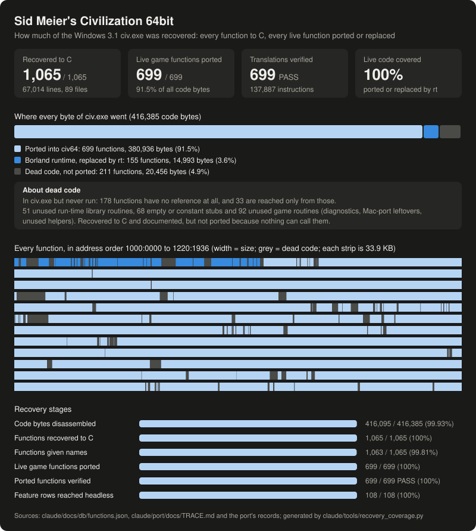

Every function of `civ.exe` has been recovered to C, and all 699 live game functions are ported into
civ64: **91.5% of the executable's code bytes**. The other 8.5% is the Borland C run-time library
(3.6%, replaced by civ64's own run-time layer) and dead code that nothing can call (4.9%). Details,
evidence and caveats: [docs/recovery-coverage.md](docs/recovery-coverage.md).

## What this repository holds, and why

| | |
|---|---|
| **Here now** | This README, the [User Guide](docs/USER-GUIDE.md) and the complete project documentation in [docs/](docs/README.md): the design, the fidelity register, the feature list, the DOS-profile tables, the phase and unit records, the reviews, the audits, the measured test results and the screenshots. The program itself is attached to each release as `civ64.exe` (since v1.2.4 also `Civ64-Win7.exe`, the build for Windows 7), and since v1.2.2 also the macOS application (`Civ64-1.3.3-macOS.dmg` in v1.3.3, `Civ64-1.3.2-macOS.dmg` in v1.3.2, `Civ64-1.3.1-macOS.dmg` in v1.3.1, `Civ64-1.3-macOS.dmg` in v1.3, `Civ64-1.2.5-macOS.dmg` in v1.2.5, `Civ64-1.2.4-macOS.dmg` in v1.2.4, `Civ64-1.2.3-macOS.dmg` in v1.2.3, `Civ64-1.2.2-macOS.dmg` in v1.2.2): the [latest release](https://github.com/Buyukcaglar/Civ64/releases/latest) is [v1.3.3](https://github.com/Buyukcaglar/Civ64/releases/tag/v1.3.3) (the macOS application `Civ64-1.3.3-macOS.dmg`; its Windows ZIP files follow); the earlier ones are [v1.3.2](https://github.com/Buyukcaglar/Civ64/releases/tag/v1.3.2) (`Civ64-1.3.2-Windows.zip`, `Civ64-1.3.2-Win7.zip` and the macOS application 1.3.2), [v1.3.1](https://github.com/Buyukcaglar/Civ64/releases/tag/v1.3.1) (from this version the Windows programs are in ZIP files, each with `units.ini` and `README-units.txt`; with the macOS application 1.3.1), [v1.3](https://github.com/Buyukcaglar/Civ64/releases/tag/v1.3) (with the macOS application 1.3), [v1.2.5](https://github.com/Buyukcaglar/Civ64/releases/tag/v1.2.5) (with the macOS application 1.2.5), [v1.2.4](https://github.com/Buyukcaglar/Civ64/releases/tag/v1.2.4) (with the macOS application 1.2.4), [v1.2.3](https://github.com/Buyukcaglar/Civ64/releases/tag/v1.2.3) (with the macOS application 1.2.3), [v1.2.2](https://github.com/Buyukcaglar/Civ64/releases/tag/v1.2.2) (with the macOS application), [v1.2.1](https://github.com/Buyukcaglar/Civ64/releases/tag/v1.2.1), [v1.2](https://github.com/Buyukcaglar/Civ64/releases/tag/v1.2), [v1.1](https://github.com/Buyukcaglar/Civ64/releases/tag/v1.1) and [v1.0](https://github.com/Buyukcaglar/Civ64/releases/tag/v1.0). |
| **Later** | The independently written code of civ64: the Windows 3.1 emulation layer and the Windows host, the run-time library replacement, the presentation (scaling, map zoom, the graphics profiles), the tests and the build scripts. It will be published here as the last task of the project. On its own it does not build a playable game. |
| **Not published** | The recovered C of `civ.exe` and the game core translated from it, the disassembly listings, the original game's string inventory, every file of the original games, and any graphics mod or graphics pack. |

The recovered C and the core translated from it are readings of the copyrighted original program,
so they are not published. The released `civ64.exe` contains none of the original games' files or
bytes (Windows, DOS, Amiga, Atari ST, PC-98 or SNES), no MT-32 ROM, no music and no graphics pack, and
neither does `Civ64.app`: they read your own copies at run time (`civ64.exe` from the archives it copies
into its `GameData` folder) and check the Windows and DOS files against the exact supported releases. The
documentation describes the work in full; where a record quoted program code, the public copy
condenses that passage into a description ([audit summary in docs/README.md](docs/README.md#9-how-the-public-copy-was-prepared)).

## Documentation

* [docs/USER-GUIDE.md](docs/USER-GUIDE.md): how to install, run and play civ64.
* [docs/README.md](docs/README.md): the whole work from start to finish (phases, methodology,
  tests, findings and measured data) with an index of every document.

## Licence

civ64's About box carries its licence: the MIT licence, Copyright (c) 2026 Onur BUYUKCAGLAR, for
the port's own code. It does not cover Sid Meier's Civilization, its program or its data, which
belong to their owners. Since 1.3 `civ64.exe` (and `Civ64.app`) also contains, unchanged, the MT-32 emulation library
libmt32emu 2.8.3 of the [Munt](https://github.com/munt/munt) project (GNU LGPL 2.1 or later), and an
adaptation of the font "Chicago 12.1" by kamekku14, after "Chicago 12" by Damien Guard (Creative Commons
Attribution-ShareAlike 3.0) for the Simulated Apple System 7 window style; the About box shows their
notices and the LGPL's text.

**Written offer (LGPL).** For at least three years from the release of version 1.3, anyone who has `civ64.exe`, `Civ64-Win7.exe` or `Civ64.app` (in `Civ64-1.3-macOS.dmg`) may ask for the complete source code of the libmt32emu 2.8.3 contained in them, together with the material needed to relink the program with a changed version of that library, as section 6 of the GNU LGPL 2.1 requires. It is given free of charge, apart from any cost of the medium. Ask by opening an issue in this repository: [github.com/Buyukcaglar/Civ64/issues](https://github.com/Buyukcaglar/Civ64/issues). The library's unchanged source is also available from the [Munt](https://github.com/munt/munt) project.
